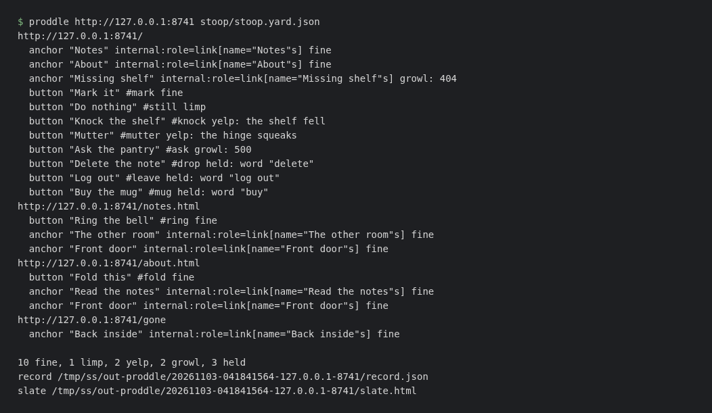
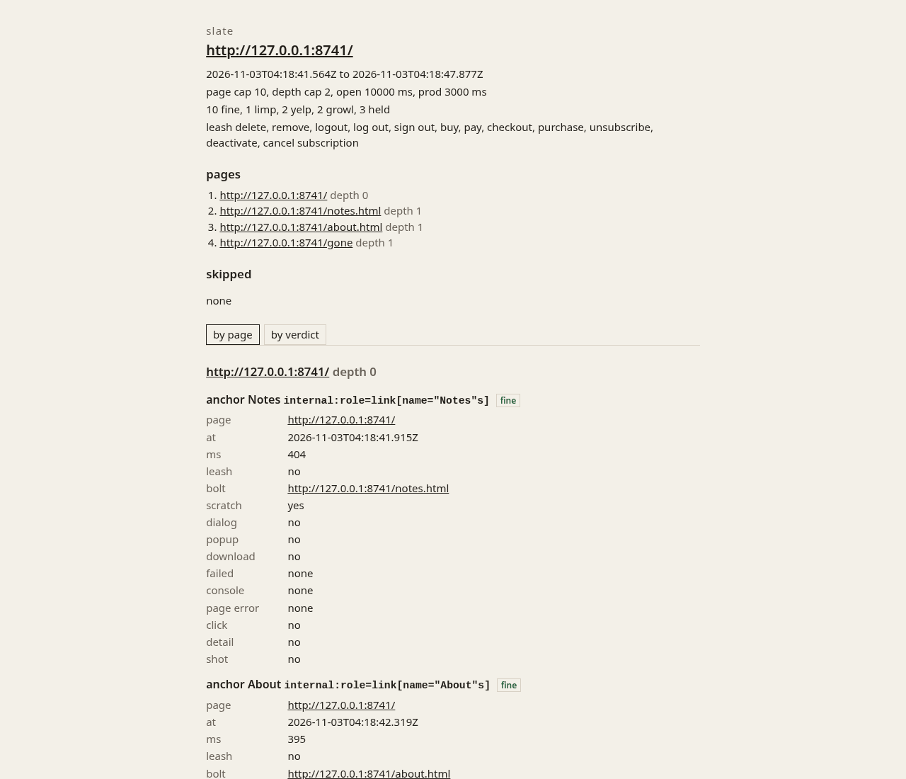

# proddle

proddle walks a website and prods the clickable things on it. Same origin only, with a cap on pages and a cap on depth. On each page it finds buttons, links, `role="button"`, and elements that look like they carry a click handler. Each one gets a prod in a fresh page. The run keeps what followed: navigation, network requests, DOM changes, console errors, uncaught page errors, and HTTP 4xx or 5xx.

This is a real run against the stoop, the demo site in `stoop/`. First the terminal, then the top of the slate it wrote.





Each prod is filed as fine, a growl, a yelp, or a limp. A growl is a broken link: the navigation failed, or a response came back 4xx or 5xx. A yelp is a console error or an uncaught page error. A limp is a click that did not seem to do anything. A navigation that lands, a DOM change, a request, or a dialog counts as fine. The slate is one HTML file, opened by itself. The run writes it next to a json record.

A leash keeps it off delete, remove, logout, log out, sign out, buy, pay, checkout, purchase, unsubscribe, deactivate, and cancel subscription. Extra words and selectors can be added.

The command walks same-origin pages from a url or a yard file. On each page it lists the clickable things, holds back the ones on the leash, and prods the rest. It prints a tally and exits 1 when a prod is a limp, a yelp, or a growl.

## Install

Node 20 or newer.

```
npm install
npx playwright install chromium
npm run build
```

`npm test` runs Vitest. `npm run build` writes `dist/latch.js`. That file is the `proddle` bin. From this repo, `node dist/latch.js` and `npm run proddle` are the same command.

## Usage

`proddle https://site.com` walks that url with the default caps, the default waits, and the built-in leash.

`proddle yards/porch.yard.json` reads the yard and walks its porch.

`proddle https://site.com yards/site.yard.json` walks that url with the yard's caps, waits, and leash.

`--leash archive` adds a word. `--leash-selector .danger` adds a css selector. Both can be repeated, and `--leash=archive` works too. They join the yard's leash. The built-in words stay.

`--out dir` sets the directory the run folder is written under. The default is `proddle-out`. `--shots` saves a png after each prod.

It prints each page, then one line per scent, then a tally:

```
https://example.com/
  anchor "Docs" #docs fine
  button "Save" #save limp
  anchor "Missing" #miss growl: 404
  button "Boom" #boom yelp: boom
  button "Delete" #del held: word "delete"

1 fine, 1 limp, 1 yelp, 1 growl, 1 held
```

A held scent is listed and not clicked. `prodWaitMs` is how long to wait after a click. The click itself gives up sooner, so one element cannot stall the run. The exit code is 1 when the tally has a limp, a yelp, or a growl, and 0 otherwise. A bad yard, an unknown flag, or a url that is not http or https, is refused before Chromium starts. A leash selector that is not css is reported and ignored.

Each run makes its own folder, named from the time and the host. Inside is `record.json` and `slate.html`. With `--shots`, pngs land in `shots/` and the record points at them. The last two lines of the output are the two paths.

## Verdicts

- fine — the click did something that showed up: a navigation that landed, a DOM change, a request, a dialog, a popup, or a download.
- limp — nothing showed up.
- yelp — a console error, an uncaught page error, or the click itself failed.
- growl — an HTTP 4xx or 5xx, or a navigation that failed. This wins over a yelp on the same prod.
- held — a leash word or selector matched. Not clicked, and not a failure.

## Record

`record.json` has the porch, the start and end time, the caps and waits, the leash words and selectors, the pages opened, the pages skipped and why, one entry per scent, and the totals.

A held scent is there with the leash reason and no click. A prod that ran has the url it landed on, or that it stayed, the failed requests with status and url, the console text, the page errors, whether a dialog, popup, or download showed up, whether the dom changed, the verdict, how long it took, and the shot path when there is one.

## Slate

`slate.html` groups those entries by page and by verdict. The two views are buttons in the page. Held ones are in there too. The porch, the time span, the caps, the tally, and the leash are at the top. Skipped urls are listed with the reason. The css and the script sit in the file, so it does not need the rest of the run except the shots, which it loads by relative path.

## Words

- yard — the config file
- porch — the start URL
- amble — the same-origin walk, bounded by page and depth caps
- prod — one click, in a fresh page
- limp — a prod that changes nothing
- yelp — a console error or an uncaught page error during a prod
- growl — an HTTP 4xx or 5xx during a prod, or a navigation that failed
- bolt — a navigation caused by a prod
- scratch — a DOM change after a prod
- leash — skip words and selectors that must not be prodded
- sniff — the look over one page for things that can be clicked
- scent — one of those: a kind, a short label, a selector, and a leash hold when it must not be prodded
- slate — the self-contained HTML report

## Yard file

A yard is JSON. `porch` is required: the start URL, `http` or `https`. It is stored as a URL href.

The other fields can be left out:

- `pageCap` — page limit for the amble. Default 20.
- `depthCap` — depth limit for the amble. Default 2.
- `leashWords` — more words to skip. Default none. The built-in leash above always applies, and these are added. Words are stored in lowercase, and repeats are dropped. How a word matches is under Sniff.
- `leashSelectors` — CSS selectors to skip. Default none. There is no built-in selector list.
- `openWaitMs` — how long a page may take to open, in milliseconds. Default 15000.
- `prodWaitMs` — how long to wait after a prod for the page to settle, in milliseconds. Default 8000.

Caps and waits have to be positive whole numbers. Skip fields have to be lists of strings. A key that is not known is refused, so a typo does not quietly become a default. `readYard` in `src/yard.ts` reads the file and returns that filled-in yard. It does not open a connection.

`yards/porch.yard.json` is a sample pointed at `http://127.0.0.1:8741`, the stoop's port. Nothing is listening until the stoop is started. The sample repeats the built-in leash words. That is redundant, and it still loads. `stoop/stoop.yard.json` is the same porch with shorter waits, which is what the demo run uses.

## Amble

`amble` in `src/amble.ts` starts at the porch and follows links. It stays on the same origin: same protocol, host, and port. `mailto:`, `tel:`, and `javascript:` are ignored, and so is any other scheme.

The hash is dropped. A trailing slash is the same page, except the root, which keeps its slash. `https://example.com//` is the root too. A bare `?` is the same as no query. A query that has a value stays, parameter order included, so `?b=1&a=2` and `?a=2&b=1` are two pages.

The porch is depth 0. A page is opened when its depth is within `depthCap`, and links are followed from a page only when the next page would still be within the cap. A `depthCap` of 1 is the porch and the pages it links to. The default is 2. `pageCap` is how many pages are opened. The default is 20. The walk is breadth-first, in the order the links were found. A page is opened once.

`readLinks` fetches a page and returns the hrefs on it. The tests pass an in-memory site and do not launch a browser. `src/chromium.ts` is the Playwright version: one headless Chromium, a fresh page per url, after `domcontentloaded`. It reads `a[href]` and sniffs that same load. `openWaitMs` is the navigation timeout. A page that only adds its links from script after that can look empty, and the sniff can miss those too.

## Sniff

On each page the walk opens, it looks for clickable things. Pages at the depth cap, and the page that fills the page cap, are not fetched while looking for links. Those are opened once, just to sniff.

Kept: an `a` with an href, a `button`, an `input` of type button, submit, or reset, `role="button"`, `role="link"`, `role="menuitem"`, and anything with an onclick attribute or an onclick property. `addEventListener` is not visible from the page. A cursor of `pointer` counts when that element sets it and its parent does not, so a card styled that way is included and the text inside it is not.

Hidden and disabled elements are left out. That includes `hidden`, `inert`, `display: none`, `visibility: hidden`, `pointer-events: none`, a zero-size box, `disabled`, and `aria-disabled="true"`.

Each scent gets one selector, the first of these that is unique on the page: an id, a `data-testid`, an `aria-label`, a role plus accessible name, the text, then a structural path such as `body > main > button:nth-of-type(2)`. The same element is listed once. Two elements that would share a selector fall back to the path.

A leash word matches on its own, ignoring case, against the text, the aria-label, the title, the value, or the href. A hyphen or underscore counts as a space, so `sign-out` matches `sign out`. The same check runs with those marks removed, so `check-out` matches `checkout`, and `signout` matches `sign out`. `pay` matches `Pay now` and `/pay`. It does not match `paper` or `payment`. A leash selector is css, checked with `element.matches`. The built-in words always apply. A held scent stays in the list with the reason.

## The stoop

`stoop/` is a small site with a few working links and buttons, and a few that are broken on purpose.

- Notes, About, and the buttons that mark, ring, or fold something should come back fine.
- Missing shelf is a link to a page the server answers with 404. That prod is a growl.
- Knock the shelf throws an uncaught error. Mutter writes a console error. Both are yelps.
- Do nothing is a button with no handler. That prod is a limp.
- Ask the pantry fetches `/pantry`, which the server answers with 500. That prod is a growl.
- Delete the note, Log out, and Buy the mug are on the leash and should be held, not clicked.

`stoop/serve.mjs` is a static file server with no dependencies. It listens on `127.0.0.1:8741`. `STOOP_PORT` changes the port. `/pantry` is the 500. Anything else missing, including `/gone`, is the 404 page.

```
npm run stoop
proddle http://127.0.0.1:8741 stoop/stoop.yard.json --out proddle-out
```

The second command exits 1. That is the broken doors, not a crash. `node stoop/expect.mjs proddle-out 1` reads the record from that folder and checks the verdicts above. It exits 1 if a broken scent came back fine, or a leashed one was clicked.

## CI

`.github/workflows/walk.yml` runs on a push to `main` and on pull requests. The job installs dependencies, installs Playwright chromium, runs the unit tests, builds, starts the stoop, and prods it. The unit tests have to pass. The stoop run is expected to exit 1, and the job uses `stoop/expect.mjs` on `record.json` instead of treating that exit as a failure. The run folder (`record.json`, `slate.html`, and `shots/` when `--shots` was passed) is uploaded as the `proddle-run` artifact. The upload step is `if: always()`, so a failing prod still leaves the folder to look at.

## Layout

- `src/latch.ts` is the command.
- `src/args.ts` decides the porch, the caps, the waits, the leash, and where the run is written.
- `src/yard.ts` reads a yard file and checks it.
- `src/links.ts` turns a raw href into a page on this origin, or nothing.
- `src/amble.ts` is the walk.
- `src/leash.ts` decides whether a leash word or selector holds a scent.
- `src/selector.ts` builds a selector from the hints gathered on the page.
- `src/sniff.ts` collects the scents.
- `src/prod.ts` clicks one scent and files what happened.
- `src/record.ts` builds the run record and writes the folder.
- `src/slate.ts` renders the slate.
- `src/chromium.ts` opens pages with Playwright, sniffs them, and prods them.
- `stoop/` is the demo site, its server, its yard, and the record check.
- `npm run typecheck` runs `tsc --noEmit`.
